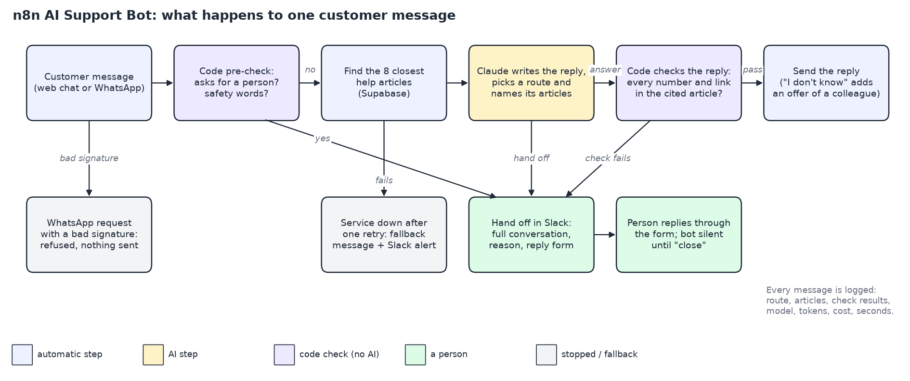

# n8n AI Support Bot

## Problem
Small businesses answer the same customer questions all day on WhatsApp and their website. A chatbot that guesses can state a wrong price or policy, make a promise the business cannot keep, or miss a customer who needs a person.

## Solution
To be written when the build lands.

## System

## Outcome
To be written from the recorded test runs only.

## Version Log
| version | date | change |
|---|---|---|
| 0.0 | 2026-10-19 | Scaffold |
