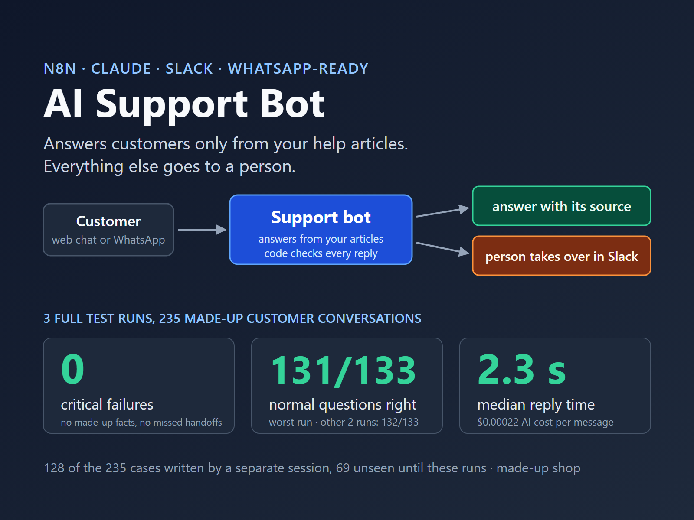

# n8n AI Support Bot

## Problem
Small businesses answer the same customer questions all day on WhatsApp and their website. A chatbot that guesses can state a wrong price or policy, make a promise the business cannot keep, or miss a customer who needs a person.

## Solution
An n8n support bot that answers customers only from the business's own help articles, and hands everything else to a person.

- **Answers from your articles, with the source.** Each answer names the article it used. If the articles do not cover the question, the bot says it does not know and offers a colleague.
- **Checks every reply before it is sent.** Code (not AI) checks that every price, number, e-mail and link in the reply appears in the cited article or in the customer's own message, and that the reply contains no discount code or promise. If a check fails, nothing is sent and a person takes over.
- **Hands off to a person in Slack.** On request ("can I talk to someone"), for order, payment or refund status, complaints, and safety issues (battery smoke, injury). The Slack message has the whole conversation and a reply form. While a person has the conversation, the bot stays silent.
- **Logs every message:** route, articles used, check results, model, tokens, cost and seconds.
- **WhatsApp-ready:** a WhatsApp Cloud API entry point that checks Meta's signature on every message, answers media with a short text, and answers a message delivered twice only once. Tested against a local stand-in for the WhatsApp API, not a live number.

The demo company is made up (Harbour E-Bikes: 25 help articles on rentals, repairs, delivery, returns and warranty). No real business or customer data is used.

## System

Customer message (web chat, WhatsApp, or the test entry) → code pre-check (person request, safety words) → search the 8 closest help articles (OpenAI embeddings, Supabase pgvector) → Claude writes a reply and picks a route (answer, don't know, decline, hand off) → code checks → send, or hand off to Slack → log.
Stack: n8n 2.43.7, Claude Haiku 5.5 (chosen by a model check against Sonnet 5.5 and Opus 5.5), OpenAI text-embedding-3-small, Supabase, Slack.

**Design rules**
- The bot has no tools that act: it cannot refund, discount, book or change anything.
- Code can turn any reply into a handoff; only the person's "close" gives the conversation back to the bot.
- Internal documents are never indexed, and the AI instructions hold no secrets.
- Conversation memory is read by conversation ID only.
- Every entry point is locked: a key header on internal webhooks, a login on the reply form and the demo web chat, and Meta's signature check on WhatsApp (a message with a bad signature gets no reply and no AI call).

**Design decisions** (2026-10-19)
- A fixed pipeline, not an AI agent with tools: routing stays predictable and testable.
- Code checks after the AI, not a second AI judging the reply ([adr/001](adr/001-code-checks-before-send.md)).
- Tests are graded by code only, never by an AI judge.
- Supabase for the article search (well known, runs online, the stored articles can be shown in its dashboard); OpenAI embeddings, because Claude has no embedding model and n8n has an OpenAI node.
- No live WhatsApp number: that needs a Meta business account and a public URL.

**Out of scope:** bookings and calendars; reading orders, accounts or a CRM (order questions go to a person); Telegram and Instagram; pushing the person's reply into an open web chat window (the web chat saves it in an outbox table); business-hours logic; more than one company; documents other than Markdown.

## Outcome
Tested on 156 made-up customer conversations: 97 written before the build and 59 written by a separate session that never saw the bot (the hold-out set). Every result below is recorded in [evals/RESULTS.md](evals/RESULTS.md), pass or fail.

- **Gated series, 3 full runs of all 156 cases (workflow version a0f05b2): PASS.** The hold-out had been opened once before, in the failed first series below.
  - 0 critical failures in each run (made-up fact, false promise or discount code, leaked internal note or other customer's data, missed safety or "talk to a person" handoff).
  - 89 of 91 normal questions passed in all 3 runs. The pass rule allows up to 3 misses.
  - Every system case passed in each run (23 of 23): every message logged, every handoff in Slack with the full conversation, outages answered with a fallback message and an alert, WhatsApp replies to the right number.
- **Speed and cost:** median 2.6 seconds per reply (90th percentile 3.3). AI cost $0.00023 per customer message ($0.123 for the 3 runs).
- **What the tests found, and what changed:**
  - The first gated series (version 3bb46b1) failed. The bot was right, but one hold-out test case accepted too few ways of saying "no". That case was corrected, with the reason recorded. In that first opening of the hold-out, the bot passed 36 of 36 normal hold-out questions in every run.
  - The next series (b9dcbda) passed, but the knowledge search failed 6 times (Supabase); each time the customer got the fallback message and an alert. Version a0f05b2 retries the search once and logs the error code: 0 search failures in its 3 runs.
  - The reply checks are strict on purpose. Sometimes they block a correct answer, for example "under 18" for an article that says "aged 16 or 17". When that happens, the customer gets a person instead of the answer.

**Newer versions (0.4 to 0.6) have not had a gated series yet.** After the PASS above, four build red teams (adversarial reviews by fresh sessions that read the code and try to break it) found more ways to make the bot fail. The fixes are listed in the version log and recorded in [evals/](evals/). The next gated series runs on a new hidden test set of 69 cases, written and sealed by a separate session.

**Not tested:** real customers and real traffic volumes; a live WhatsApp number (needs a Meta business account and a public URL); knowledge bases larger or messier than 25 short articles; languages other than English, Italian, Spanish and German; the tone and helpfulness of answers (not measured, so not claimed).

## Version Log
| version | date | change |
|---|---|---|
| 0.0 | 2026-10-19 | Scaffold; eval gate and 97 test cases written before the build; 59 hold-out cases sealed by a separate session |
| 0.1 | 2026-10-20 | Workflows built and tested; first gated series FAIL (test case wording, corrected by a recorded decision) |
| 0.2 | 2026-10-20 | Gated series PASS on b9dcbda (hold-out seen) |
| 0.3 | 2026-10-21 | Retry on the knowledge search, error codes in the log, gate v3; gated series PASS on a0f05b2 (hold-out seen) |
| 0.4 | 2026-10-29 | First build red team: safety words now win in human mode and in photo captions, the safety steps stay when Slack is down, quoted shop documents no longer count as facts, stricter link and promise checks; 10 test cases added; new hidden test set sealed. Visible run: 0 critical failures, 57 of 57 normal questions (not gated) |
| 0.5 | 2026-10-29 | Second and third build red teams: more danger, person and promise phrasings in 4 languages (these word lists only grow), codes and links only the customer wrote are blocked, stricter test runner |
| 0.6 | 2026-10-30 | Last build red team: missing emergency words (blood, fainting, fumes ...), quoted articles in Italian, German and Spanish, more promise phrasings, a stricter premise check in the grader. Not yet run in n8n |
